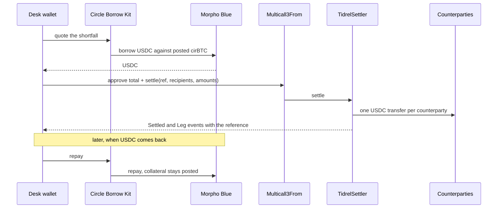

# Tidrel

Settle in USDC. Keep your bitcoin. **Live on Arc mainnet:** [tidrel.vercel.app](https://tidrel.vercel.app)

<br clear="left">


  

## The story

I have never run an OTC desk, so I will not hand you a war story.

What I could check is that paying the USDC leg of a BTC trade means holding idle USDC, selling the BTC you wanted to keep, or borrowing from someone with relationship terms.

So I made the loan last exactly as long as the trade does, and measured it: [44 seconds and 0.000001 USDC of interest, on Arc mainnet](https://explorer.arc.io/tx/0xd7bdab379078589562720e46b36082265b5e7388a62ff177e3b7723b65ef93be).

## One-liner

I did not build a lending protocol, a custody service, or a dashboard with a database behind it. I built a desk that borrows only the USDC a trade is short, pays every counterparty in one contract call, and shows every figure as a link to Arc.

## How it works

Collateral goes in once and stays. USDC goes out only as far as a trade is short, and only after the guards say yes.
Payouts are one batch, all or nothing, and each carries the trade reference on-chain.
Repay closes the loan and leaves the collateral posted for the next trade.
Every draw, payout and repay leaves an event, and the site rebuilds its history from those events alone.

| Operation | Result |
|---|---|
| Post cirBTC | Once. The first draw posts what it needs, then it stays |
| Draw | Only the shortfall. Refused if health would drop below 1.20 or the market cannot lend it |
| Settle | One batch: approve the exact total, then pay every counterparty. All land or none do |
| Reuse a trade reference | Rejected by the contract, even from another browser |
| Payout fails after a draw | Shown as "drawn, not settled", with Retry payout and Repay now |
| Repay | Smaller of wallet USDC and debt. Never above the debt |
| Smart-contract wallet | Refused up front, with the reason |



## Try it in 2 minutes

**Web path, no wallet:**

1. Open the [demo desk](https://tidrel.vercel.app/view/0x100E8AF5Ba507641Bb87c7D3229B8d458b78ca04). It is the wallet that ran every cycle below, read live from Arc mainnet.
2. Open the [proof page](https://tidrel.vercel.app/proof) and click any draw, payout or repay.

**The dare:** find a number on the site that does not resolve to an Arc transaction or contract.

**Command path, straight from the chain:**

```bash
npx tsx scripts/history.ts 0x100E8AF5Ba507641Bb87c7D3229B8d458b78ca04 24575996
```

Expected: six rows. BLK-0413, 0415, 0416 and 0417 are repaid with their draw, payout and repay hashes, BLK-0414 is self-funded, and one repaid draw has no reference because it was a repay test.

**Your own wallet:** open the [desk](https://tidrel.vercel.app/desk), connect a regular wallet on Arc mainnet, click "Settle a trade". The sheet prices the plan before anything is signed. To draw, the wallet needs cirBTC. Without it, the sheet still settles from your own USDC.

## 9 ways I tried to break Tidrel

| Case | Outcome | Proof |
|---|---|---|
| Settle the same trade reference twice | The second call reverts. A different wallet can still use that reference | `test_referenceCannotRepeatForSamePayer`, `test_sameReferenceIsFreeForAnotherPayer` in [TidrelSettler.t.sol](contracts/test/TidrelSettler.t.sol). Live: BLK-0417 is refused in the sheet |
| One payout leg fails halfway through a batch | Every earlier leg and the reference roll back | `test_allOrNothing_failedLegRollsBackEarlierLegsAndReference` in [TidrelSettler.t.sol](contracts/test/TidrelSettler.t.sol) |
| The token answers `false` instead of reverting | Treated as a failed transfer | `test_tokenReturningFalseFails` in [TidrelSettler.t.sol](contracts/test/TidrelSettler.t.sol) |
| Draw that would take health to 1.19 | Refused before signing. Exactly 1.20 is allowed | [settle.plan.test.ts](test/settle.plan.test.ts) |
| Draw above what the market can lend | Refused before it is even quoted. Liquidity moved from 4.96 to 40,004.96 USDC during the build, so it is read live | [settle.plan.test.ts](test/settle.plan.test.ts) |
| Draw lands, payout fails | "Drawn, not settled". Retry pays only, never draws twice | [settle-flow.test.ts](test/settle-flow.test.ts), [history.test.ts](test/history.test.ts) |
| Connect a smart-contract wallet, or the wrong network | Refused with the reason, or a switch to Arc mainnet | [wallet.test.ts](test/wallet.test.ts), [connect.test.ts](test/connect.test.ts) |
| Circle's service still shows debt after a repay | Debt is read from Morpho. On mainnet the service lagged about 20 seconds | [debt.test.ts](test/debt.test.ts) |
| A figure in the UI that did not come from the chain | Fails the build | [no-literals.test.ts](test/no-literals.test.ts) |

Real USDC on Arc cannot run inside a local Foundry fork, so the contract was also checked against live mainnet state with a read-only simulation: [scripts/sim-settler.mts](scripts/sim-settler.mts).

## Addresses and live proof

| Name | Address |
|---|---|
| TidrelSettler | [`0xf041C51cA3E5F37D9F75C574AAe5aeBf42754957`](https://explorer.arc.io/address/0xf041C51cA3E5F37D9F75C574AAe5aeBf42754957) |
| USDC | [`0x3600000000000000000000000000000000000000`](https://explorer.arc.io/address/0x3600000000000000000000000000000000000000) |
| cirBTC | [`0x171A4217b86A807A64eB94757Db6849fb4bDbAA0`](https://explorer.arc.io/address/0x171A4217b86A807A64eB94757Db6849fb4bDbAA0) |
| Morpho Blue | [`0x34cd04070dd72b14e241112f6d83812df5af7fcd`](https://explorer.arc.io/address/0x34cd04070dd72b14e241112f6d83812df5af7fcd) |
| Multicall3From | [`0x522fAf9A91c41c443c66765030741e4AaCe147D0`](https://explorer.arc.io/address/0x522fAf9A91c41c443c66765030741e4AaCe147D0) |
| Memo | [`0x5294E9927c3306DcBaDb03fe70b92e01cCede505`](https://explorer.arc.io/address/0x5294E9927c3306DcBaDb03fe70b92e01cCede505) |
| Demo desk wallet | [`0x100E8AF5Ba507641Bb87c7D3229B8d458b78ca04`](https://explorer.arc.io/address/0x100E8AF5Ba507641Bb87c7D3229B8d458b78ca04) |

Arc mainnet, chain ID 5042. Market: cirBTC/USDC on Morpho Blue, id `0xc2db905f174e5defcce01d321b09f15f78856a36a21b90cc7e1abbc29225815d`. TidrelSettler was deployed in [this transaction](https://explorer.arc.io/tx/0xbd7c495127b311d2a756402c13e9483974875ae892e2ce04b5a806fd152e0894), built from commit `e2fd3aa`, source in [`contracts/src/TidrelSettler.sol`](contracts/src/TidrelSettler.sol). It has no owner, no fee and no upgrade path. Explorer source verification: pending.

**Arc features used, one mainnet transaction each:**

| Feature | What Tidrel uses it for | Proof |
|---|---|---|
| Circle Borrow Kit | Quotes, opens and repays the loan against cirBTC | [draw](https://explorer.arc.io/tx/0xb861dc5e9c2f9fe6a6ae0c1063adcea340b6ae4130d6fc0fafaa92106b1a5a86), [repay](https://explorer.arc.io/tx/0xd7bdab379078589562720e46b36082265b5e7388a62ff177e3b7723b65ef93be) |
| cirBTC | The collateral, posted by the first draw and reused after | [swap into cirBTC](https://explorer.arc.io/tx/0xd74133cdfe93ac9545fb18fff59d5e83fcecc9b381bcb46bce5125e7f02c358b), [first draw posting it](https://explorer.arc.io/tx/0x41a7fa6b4fe3fae0ef50b9fa4cfaf1853142bc5295ee7ced93590ba20556d607) |
| Multicall3From | Sends approve and settle as one batch that keeps the desk as sender | [batch](https://explorer.arc.io/tx/0xf839e087bd40643d9583c050a8bfda686c1488300c2a6454909dbee284f9521c) |
| Memo | Tagged each payment with the trade reference in the first run | [BLK-0413 payout, 3 Memo events](https://explorer.arc.io/tx/0x9357f0a5f0b160ddc2d4bf34e3bd7fc5ff13e69e2f60a945983fe7fcf4243302) |
| USDC as gas | Every transaction here pays its gas in USDC | any row above |
| TidrelSettler (this repo) | One-call payout and one-time trade references | [settle](https://explorer.arc.io/tx/0xf839e087bd40643d9583c050a8bfda686c1488300c2a6454909dbee284f9521c) |

## I use this

The demo desk wallet ran four full cycles and one self-funded payout. All draws were 1.20 USDC and paid three counterparties. The [proof page](https://tidrel.vercel.app/proof) rebuilds this table from the chain on every refresh.

| Reference | Open for | Interest | Draw | Payout | Repay |
|---|---|---|---|---|---|
| BLK-0413 | 199 s | 0.000001 USDC | [tx](https://explorer.arc.io/tx/0x41a7fa6b4fe3fae0ef50b9fa4cfaf1853142bc5295ee7ced93590ba20556d607) | [tx](https://explorer.arc.io/tx/0x9357f0a5f0b160ddc2d4bf34e3bd7fc5ff13e69e2f60a945983fe7fcf4243302) | [tx](https://explorer.arc.io/tx/0x9421265ab62006d850bf879589b52da42edf2cf676b6b6911af76d2d435557bb) |
| BLK-0415 | 46 s | 0.000001 USDC | [tx](https://explorer.arc.io/tx/0xe801f19df7e866e3832a7b790e950e9f055a5973ea046052e0b2cd000ec2229c) | [tx](https://explorer.arc.io/tx/0x9d539c2172ab31e2b6f925b22e4b76e2ef0799e03e7b247c2fdd578c761fb5d1) | [tx](https://explorer.arc.io/tx/0x32050d70208093a1c71f4fb4b9f5ef06569bbc4d76f167d6a55aff25e87fe193) |
| BLK-0416 | 44 s | 0.000001 USDC | [tx](https://explorer.arc.io/tx/0xb861dc5e9c2f9fe6a6ae0c1063adcea340b6ae4130d6fc0fafaa92106b1a5a86) | [tx](https://explorer.arc.io/tx/0xf839e087bd40643d9583c050a8bfda686c1488300c2a6454909dbee284f9521c) | [tx](https://explorer.arc.io/tx/0xd7bdab379078589562720e46b36082265b5e7388a62ff177e3b7723b65ef93be) |
| BLK-0417 | 45 s | 0.000001 USDC | [tx](https://explorer.arc.io/tx/0xcf0c3b825f75d44042f70907f182ed4aae3421130211dc7ecdaa581dafacc9f4) | [tx](https://explorer.arc.io/tx/0x276f53ef104cab451397e997cd1b24ef30692e14eec07c899b3ad57adeb37224) | [tx](https://explorer.arc.io/tx/0xe4f56b29a7f11b2b2af59f6acdf66ce2c8006debe24e18ecc164fd1f25d579a5) |

BLK-0413 paid through Memo. BLK-0415 to BLK-0417 paid through TidrelSettler. [BLK-0414](https://explorer.arc.io/tx/0x0625969d6e32ecf25714f4e2aaad59a3219c02bf55af9f43b8c54fc0047b49d5) was paid from the wallet with no draw. One more draw and repay, with no payout, came from testing the repay screen. Nobody outside this wallet has used it yet.

## How this differs

| Alternative | What it does | How Tidrel differs |
|---|---|---|
| Pre-fund USDC, or sell BTC to cover the leg | Ties up idle capital, or gives up the BTC | Borrows only the shortfall, for as long as the trade takes |
| Custodial credit lines from a broker or lender | A credit process, relationship terms, funds held by the lender | On-chain and non-custodial. No account. The desk's wallet signs |
| Borrowing on Morpho by hand | A raw borrow with no link to a trade | The draw is sized from the shortfall, paid out in one batch and tagged with the reference |
| A script that borrows, then sends USDC | Two unchecked steps | Guards before signing, all-or-nothing payout, one-time references, recovery for a half-finished settlement, history from chain |

## Honest limitations

- Amounts are tiny. The run was sized to a 5 USDC budget and each draw was 1.20 USDC. A 45 second loan costing 0.000001 USDC is not a pricing study, and the code has not run at size.
- The counterparties are wallets controlled by the builder, and they sent the USDC back after each payout. The cycles prove the mechanism, not demand.
- It depends on Circle's Borrow service for quotes and for opening and repaying loans. When the service is down, Tidrel shows chain data only and disables draws.
- A settlement is two transactions, the draw and then the payout batch. A failure between them is handled and shown, but it can happen.
- Regular wallets only. Smart-contract accounts are refused.
- Market liquidity swings hard. A draw is refused when the market cannot lend it.
- TidrelSettler is unaudited, and its source is not yet verified on the explorer.
- The browser flow was tested with a scripted wallet standing in for the extension. A pass with a real MetaMask or Rabby is still to do.

## What's real

Everything in the shipped path is real: the deployed contract, the repaid cycles, and every figure on the site, which is read from Arc mainnet, with no mocked values in this repository. Pending: explorer source verification and an independent audit.

```bash
npm test                                          # 256 tests
cd contracts && forge install foundry-rs/forge-std --no-git && forge test   # 8 tests
```

## Run locally

```bash
git clone https://github.com/mystiquemide/tidrel.git
cd tidrel
npm ci
npm test
npm run dev    # http://localhost:3000
```

Public settings have defaults. `.env.example` lists the ones you can change. No keys are needed to read.

## Next

Pilot with a few OTC desks and measure real settlement sizes.

MIT licensed.
