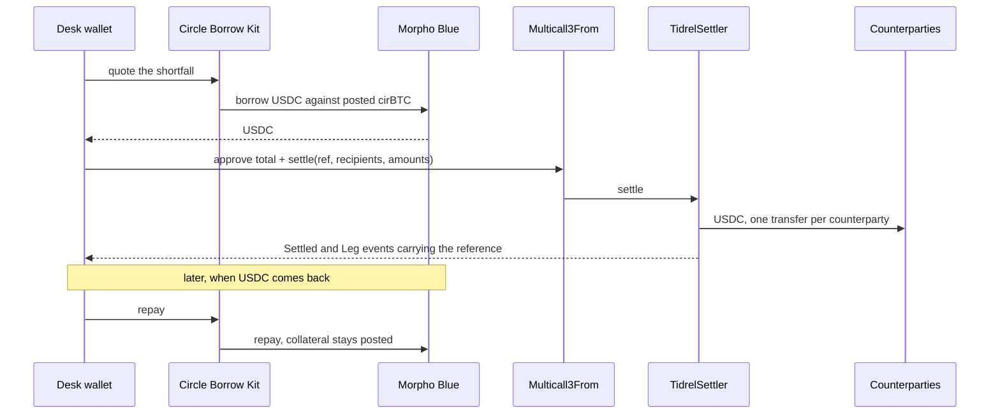

# Tidrel

Draw USDC against your cirBTC the moment a trade settles, and repay it the second USDC comes back. **Live on Arc mainnet:** [tidrel.vercel.app](https://tidrel.vercel.app)

<br clear="left">


## The mainnet cycle

I do not have a dramatic personal receipt behind this. I have four repaid loans on Arc mainnet, each one a real trade-shaped cycle, and every number links to its transaction.

| Reference | Open for | Interest | Draw | Payout (3 counterparties) | Repay |
|---|---|---|---|---|---|
| BLK-0413 | 199 s | 0.000001 USDC | [tx](https://explorer.arc.io/tx/0x41a7fa6b4fe3fae0ef50b9fa4cfaf1853142bc5295ee7ced93590ba20556d607) | [tx](https://explorer.arc.io/tx/0x9357f0a5f0b160ddc2d4bf34e3bd7fc5ff13e69e2f60a945983fe7fcf4243302) | [tx](https://explorer.arc.io/tx/0x9421265ab62006d850bf879589b52da42edf2cf676b6b6911af76d2d435557bb) |
| BLK-0415 | 46 s | 0.000001 USDC | [tx](https://explorer.arc.io/tx/0xe801f19df7e866e3832a7b790e950e9f055a5973ea046052e0b2cd000ec2229c) | [tx](https://explorer.arc.io/tx/0x9d539c2172ab31e2b6f925b22e4b76e2ef0799e03e7b247c2fdd578c761fb5d1) | [tx](https://explorer.arc.io/tx/0x32050d70208093a1c71f4fb4b9f5ef06569bbc4d76f167d6a55aff25e87fe193) |
| BLK-0416 | 44 s | 0.000001 USDC | [tx](https://explorer.arc.io/tx/0xb861dc5e9c2f9fe6a6ae0c1063adcea340b6ae4130d6fc0fafaa92106b1a5a86) | [tx](https://explorer.arc.io/tx/0xf839e087bd40643d9583c050a8bfda686c1488300c2a6454909dbee284f9521c) | [tx](https://explorer.arc.io/tx/0xd7bdab379078589562720e46b36082265b5e7388a62ff177e3b7723b65ef93be) |
| BLK-0417 | 45 s | 0.000001 USDC | [tx](https://explorer.arc.io/tx/0xcf0c3b825f75d44042f70907f182ed4aae3421130211dc7ecdaa581dafacc9f4) | [tx](https://explorer.arc.io/tx/0x276f53ef104cab451397e997cd1b24ef30692e14eec07c899b3ad57adeb37224) | [tx](https://explorer.arc.io/tx/0xe4f56b29a7f11b2b2af59f6acdf66ce2c8006debe24e18ecc164fd1f25d579a5) |

Each draw was 1.20 USDC. BLK-0413 paid through Arc's Memo contract. BLK-0415 to BLK-0417 paid through TidrelSettler, the contract in this repo. The live [proof page](https://tidrel.vercel.app/proof) rebuilds this table from the chain on every refresh.

## One-liner

I did not build a lending protocol, a custody service, or a dashboard with a database behind it. I built a desk that borrows only the USDC a trade is short, pays everyone in one contract call, and shows every figure as a link to Arc.

## How it works

A desk posts cirBTC once and keeps it posted. When a trade needs USDC, Tidrel draws only the shortfall through Circle's Borrow Kit against that cirBTC. One batch from the desk's wallet approves the total and calls `TidrelSettler.settle`, which pays every counterparty and records the trade reference on-chain. When USDC comes back, one repay closes the loan and the collateral stays posted for the next trade.



| Operation | What happens |
|---|---|
| Plan | Reads the position, sizes the draw to the shortfall, checks the health guard and market liquidity. Nothing is signed. |
| Draw | Borrow Kit opens or tops up the loan. The first draw posts the collateral it needs. |
| Settle | One batch: approve the exact total, then `settle`. All payments land or none do. |
| Repay | Smaller of wallet USDC and debt. Collateral stays posted. |
| History | Rebuilt from Morpho and TidrelSettler events. No database. |

## Try it in 2 minutes

No wallet needed to look:

1. Open the [demo desk](https://tidrel.vercel.app/view/0x100E8AF5Ba507641Bb87c7D3229B8d458b78ca04). It is the wallet that ran the cycles above, read live from Arc mainnet. Collateral, debt, the tide line and every settlement row link to the explorer.
2. Open the [proof page](https://tidrel.vercel.app/proof) and click a draw, payout or repay link. Each one resolves to a real transaction.
3. Open [safety rules](https://tidrel.vercel.app/safety) and [contracts](https://tidrel.vercel.app/contracts) for what is enforced and every address used.

To settle a trade yourself, open the [desk](https://tidrel.vercel.app/desk), connect a regular (non smart-contract) wallet on Arc mainnet, and click "Settle a trade". The sheet prices the plan before anything is signed. A wallet needs cirBTC to draw, or enough USDC to pay from its own balance.

## Arc features used

| Arc or Circle feature | What Tidrel uses it for | Mainnet proof |
|---|---|---|
| Circle Borrow Kit | Quotes, opens and repays the loan against cirBTC | [draw](https://explorer.arc.io/tx/0xb861dc5e9c2f9fe6a6ae0c1063adcea340b6ae4130d6fc0fafaa92106b1a5a86), [repay](https://explorer.arc.io/tx/0xd7bdab379078589562720e46b36082265b5e7388a62ff177e3b7723b65ef93be) |
| cirBTC | The collateral. Posted by the first draw and reused by later ones | [swap into cirBTC](https://explorer.arc.io/tx/0xd74133cdfe93ac9545fb18fff59d5e83fcecc9b381bcb46bce5125e7f02c358b), [first draw posting it](https://explorer.arc.io/tx/0x41a7fa6b4fe3fae0ef50b9fa4cfaf1853142bc5295ee7ced93590ba20556d607) |
| Multicall3From | Sends approve and settle as one batch that keeps the desk as the sender | [batch](https://explorer.arc.io/tx/0xf839e087bd40643d9583c050a8bfda686c1488300c2a6454909dbee284f9521c) |
| Memo | Tagged each payment with the trade reference in the first run | [BLK-0413 payout, 3 Memo events](https://explorer.arc.io/tx/0x9357f0a5f0b160ddc2d4bf34e3bd7fc5ff13e69e2f60a945983fe7fcf4243302) |
| USDC as gas | Every transaction above pays its gas in USDC | any transaction in this table |
| TidrelSettler (this repo) | Pays all counterparties in one call and rejects a reused reference | [deploy](https://explorer.arc.io/tx/0xbd7c495127b311d2a756402c13e9483974875ae892e2ce04b5a806fd152e0894), [settle](https://explorer.arc.io/tx/0xf839e087bd40643d9583c050a8bfda686c1488300c2a6454909dbee284f9521c) |

## Safety rules

- Draws stop before they get risky: Tidrel refuses any draw that would take health below 1.20, and checks again right before you sign.
- A draw never exceeds the market's available liquidity, which is read live.
- Payouts land together or not at all. One batch, no partial failure inside it.
- A trade reference can be used once per wallet. The contract rejects a repeat on its own, from any browser or device.
- Regular wallets only. Smart-contract accounts are refused up front with an explanation.
- Your wallet signs every step. Tidrel holds no funds, no keys, and runs no backend that can move money.

If a draw lands and the payout does not, the history marks it "drawn, not settled" and the desk offers Retry payout and Repay now. The retry never draws twice.

## Checked by tests

256 Vitest tests and 8 Foundry tests. The ones that carry the claims above:

| Claim | Where it is checked |
|---|---|
| Health guard refuses below 1.20, before and at signing | `test/settle.plan.test.ts`, `test/settle.execute.test.ts` |
| Payout batch encodes approve plus settle and never lets a call fail silently | `test/settler.test.ts` |
| All-or-nothing payout, reference reuse rejected, zero left in the contract | `contracts/test/TidrelSettler.t.sol` |
| Draw, payout and repay are matched from chain events, including drawn-not-settled | `test/history.test.ts` |
| Repay is capped at debt and wallet, collateral stays posted | `test/repay.test.ts` |
| Debt is read from Morpho when Circle's service lags | `test/debt.test.ts` |
| No hardcoded figures in the UI source | `test/no-literals.test.ts` |

Real USDC on Arc cannot run inside a local Foundry fork, so the contract was also checked against live mainnet state with a read-only simulation: `scripts/sim-settler.mts`.

## Contracts and addresses

| Name | Address |
|---|---|
| TidrelSettler | [`0xf041C51cA3E5F37D9F75C574AAe5aeBf42754957`](https://explorer.arc.io/address/0xf041C51cA3E5F37D9F75C574AAe5aeBf42754957) |
| USDC | [`0x3600000000000000000000000000000000000000`](https://explorer.arc.io/address/0x3600000000000000000000000000000000000000) |
| cirBTC | [`0x171A4217b86A807A64eB94757Db6849fb4bDbAA0`](https://explorer.arc.io/address/0x171A4217b86A807A64eB94757Db6849fb4bDbAA0) |
| Morpho Blue | [`0x34cd04070dd72b14e241112f6d83812df5af7fcd`](https://explorer.arc.io/address/0x34cd04070dd72b14e241112f6d83812df5af7fcd) |
| Multicall3From | [`0x522fAf9A91c41c443c66765030741e4AaCe147D0`](https://explorer.arc.io/address/0x522fAf9A91c41c443c66765030741e4AaCe147D0) |
| Memo | [`0x5294E9927c3306DcBaDb03fe70b92e01cCede505`](https://explorer.arc.io/address/0x5294E9927c3306DcBaDb03fe70b92e01cCede505) |
| Demo desk wallet | [`0x100E8AF5Ba507641Bb87c7D3229B8d458b78ca04`](https://explorer.arc.io/address/0x100E8AF5Ba507641Bb87c7D3229B8d458b78ca04) |

Chain: Arc mainnet, chain ID 5042. The market is cirBTC/USDC on Morpho Blue, id `0xc2db905f174e5defcce01d321b09f15f78856a36a21b90cc7e1abbc29225815d`. TidrelSettler has no owner, no fee and no upgrade path. Its source is in [`contracts/src/TidrelSettler.sol`](contracts/src/TidrelSettler.sol). Explorer source verification is not done yet.

## Real usage

The mainnet record above is all of it: the demo desk wallet ran four full cycles and one self-funded payout ([BLK-0414](https://explorer.arc.io/tx/0x0625969d6e32ecf25714f4e2aaad59a3219c02bf55af9f43b8c54fc0047b49d5)), plus one draw and repay with no payout while testing the repay screen. There are no outside users yet and no desk has used it.

## How this differs

| Alternative | What it does | How Tidrel differs |
|---|---|---|
| Pre-fund USDC, or sell BTC to cover the leg | Ties up idle capital, or gives up the BTC | Borrows only the shortfall, for as long as the trade takes |
| Custodial credit lines from a broker or lender | Credit process, relationship terms, funds held by the lender | On-chain, non-custodial, no account. The desk's wallet signs |
| Borrowing on Morpho by hand | A raw borrow with no link to a trade | Ties the draw to the settlement: priced from the shortfall, paid out in one batch, tagged with the reference |
| A script that borrows then sends USDC | Two unchecked steps | Guards before signing, all-or-nothing payout, one-time references, drawn-not-settled recovery, history from chain |

## Honest limitations

- Amounts are tiny. The mainnet run is sized to a 5 USDC budget and each draw was 1.20 USDC. A 45 second loan costing 0.000001 USDC is not a pricing study. The same code path runs at any size, but it has not been run at size.
- The counterparties in the run are wallets controlled by the builder, and they sent the USDC back after each payout. The cycles prove the mechanism, not demand.
- It depends on Circle's Borrow service for quotes and for opening and repaying loans. When the service is unreachable, Tidrel shows chain data only and disables draws.
- A settlement is two transactions: the draw, then one batch that pays everyone. A failure between them is handled and shown, but it can happen.
- Regular wallets only. Smart-contract accounts are refused.
- Market liquidity swings hard. A draw is refused when the market cannot lend it.
- TidrelSettler is unaudited and its source is not yet verified on the explorer.
- Tested with a scripted wallet standing in for the wallet extension. A real MetaMask or Rabby pass is still to do.

## What's real

Everything in the shipped path is real: the deployed contract, the four repaid cycles, and every figure on the site, which is read from Arc mainnet. There are no mocked values. Pending: explorer source verification of TidrelSettler, and an independent audit.

## Run locally

```bash
git clone https://github.com/mystiquemide/tidrel.git && cd tidrel
npm ci
cp .env.example .env.local   # public settings only, no secrets
npm test                     # 256 tests
npm run dev                  # http://localhost:3000
```

Contract tests: `cd contracts && forge install foundry-rs/forge-std --no-git && forge test`.

## Next

Pilot with a few OTC desks and measure real settlement sizes.

## License

MIT
