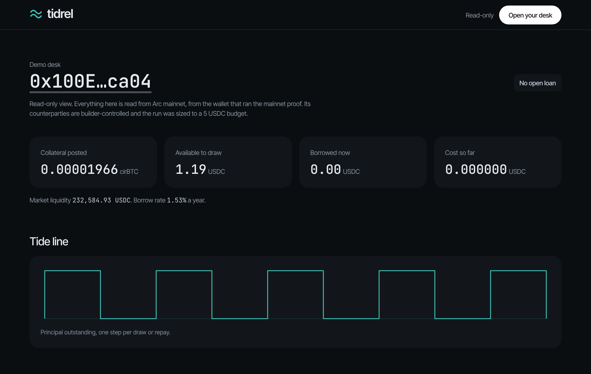
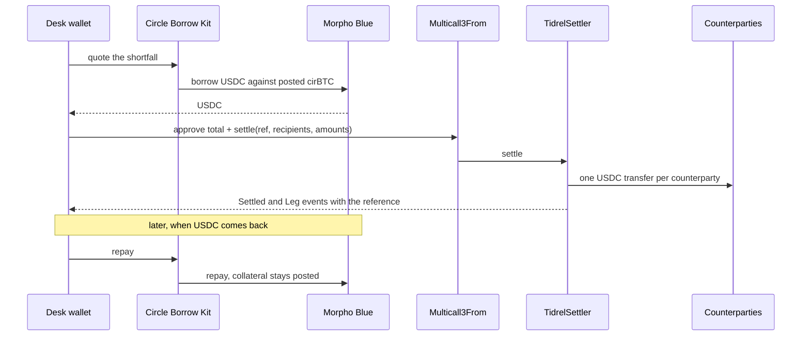

<div align="center">


# Tidrel

Draw USDC against your cirBTC the moment a trade settles, and repay it the second USDC comes back.

**Live on Arc mainnet:** [tidrel.midelabs.xyz](https://tidrel.midelabs.xyz)

[Repo](https://github.com/mystiquemide/tidrel) · [Contracts](#contracts-and-addresses) · Built by [MystiqueMide](https://github.com/mystiquemide)

</div>

## The problem

A desk settling a BTC trade in USDC has three options for the USDC leg today. It can hold idle USDC in advance, sell the BTC it wanted to keep, or ask a broker for a credit line, which comes with relationship terms and a credit process. Each one ties up capital for longer than the trade actually needs it.

What the sources say:

- **OTC is growing faster than exchange spot.** "Institutional spot OTC volumes expanded +109% YoY, while top-20 CEXs grew just +9% YoY by year-end 2025," and "40% of surveyed institutions name OTC as their first-choice execution venue, routing over half of trades off-screen." ([Finery Markets, State of Crypto OTC 2026](https://finerymarkets.com/blog/state-of-crypto-otc-2026))
- **Prefunding parks capital.** "Requiring full payment before each one would force it to keep enormous sums idle, pre-positioned across venues, just to be ready to trade." That is "capital-inefficient and operationally clumsy." ([Mintarex, Crypto OTC credit and financing](https://mintarex.com/en/blog/crypto-otc-credit-and-financing-for-institutions))
- **Credit comes with limits, terms and cost.** "The desk extends a defined credit limit a client can trade against, settling periodically," and most credit beyond modest terms "is secured by collateral." (same source) A bitcoin-backed lender like Ledn lists 9.25% to 11.49% APR depending on size, holds the collateral in custody, and quotes a "median funding 3.8 hours." ([Ledn](https://www.ledn.io/borrowing))
- **Selling the BTC costs something.** "For many BTC holders, selling is a blunt instrument that can reduce potential upside exposure, disrupt strategic treasury operations, create accounting complexity, or trigger taxable events." ([Circle, How USDC and cirBTC unlock capital efficiency](https://www.circle.com/blog/how-usdc-and-cirbtc-unlock-capital-efficiency))
- **The settlement window is short and has risk in it.** "Stablecoin settlement via blockchain networks can complete in minutes," and in a bilateral trade there is "a window between execution and final settlement during which one side has committed, but the other has not yet delivered." ([Fasset, OTC crypto settlement](https://fasset.com/blog/otc-crypto-settlement-for-treasury-teams/))
- **Circle built cirBTC for this buyer.** It is "designed for eligible institutional participants, including OTC desks, market makers, and DeFi protocols," and cirBTC can be used as collateral on lending markets with USDC paid out. ([Circle, cirBTC](https://www.circle.com/cirbtc))
- **The raw borrow already happens on Arc mainnet. Nothing ties it to a settlement.** Read from Arc mainnet at block 24,631,697: the cirBTC/USDC market on Morpho Blue has 194,225,393 USDC borrowed out of 194,926,201 supplied, 99.64% utilization, at a borrow rate near 1.40% a year. That figure moves every block, and the desk page shows the live one.

Set against that, the loans in this repo lasted 44 to 199 seconds, at 0.000001 USDC each. These are different products with different collateral, so the rates are context, not a like-for-like comparison.

## The solution

Tidrel turns cirBTC into USDC for exactly as long as a trade takes to settle. A desk posts cirBTC once. When a trade settles, Tidrel draws only the USDC shortfall through Circle's Borrow Kit and pays every counterparty in one Arc transaction, with the trade reference recorded on-chain. When USDC comes back, one click repays. There is no custody, no account and no database: the desk's own wallet signs every step.

## The mainnet cycle

In one mainnet cycle, a draw stayed open for **44 seconds** and cost **0.000001 USDC** in interest.

[Draw](https://explorer.arc.io/tx/0xb861dc5e9c2f9fe6a6ae0c1063adcea340b6ae4130d6fc0fafaa92106b1a5a86) · [Payout, 3 counterparties](https://explorer.arc.io/tx/0xf839e087bd40643d9583c050a8bfda686c1488300c2a6454909dbee284f9521c) · [Repay](https://explorer.arc.io/tx/0xd7bdab379078589562720e46b36082265b5e7388a62ff177e3b7723b65ef93be)

Four repaid cycles so far, 44 to 199 seconds each, all at 0.000001 USDC of interest. The live [proof page](https://tidrel.midelabs.xyz/proof) lists every one with its three transactions.



## How it works

1. The desk posts cirBTC once. The first draw posts what it needs and the collateral stays posted afterwards.
2. When a trade needs USDC, Tidrel reads the position and sizes the draw to the shortfall. It refuses a draw that would take health below 1.20 or exceed the market's liquidity.
3. Circle's Borrow Kit opens or tops up the loan on Morpho Blue.
4. One batch from the desk's wallet approves the exact total and calls `TidrelSettler.settle`, which pays every counterparty and records the trade reference. All payments land or none do.
5. When USDC comes back, one repay closes the loan. The collateral stays posted for the next trade.



## Arc features used

| Feature | What Tidrel uses it for | Mainnet transaction |
|---|---|---|
| Circle Borrow Kit | Quotes, opens and repays the loan against cirBTC | [draw](https://explorer.arc.io/tx/0xb861dc5e9c2f9fe6a6ae0c1063adcea340b6ae4130d6fc0fafaa92106b1a5a86), [repay](https://explorer.arc.io/tx/0xd7bdab379078589562720e46b36082265b5e7388a62ff177e3b7723b65ef93be) |
| cirBTC | The collateral. The first draw posts it and later draws reuse it | [first draw posting it](https://explorer.arc.io/tx/0x41a7fa6b4fe3fae0ef50b9fa4cfaf1853142bc5295ee7ced93590ba20556d607) |
| Multicall3From | Sends approve and settle as one batch that keeps the desk as sender | [batch](https://explorer.arc.io/tx/0xf839e087bd40643d9583c050a8bfda686c1488300c2a6454909dbee284f9521c) |
| Memo | Tagged each payment with the trade reference in the first cycle | [payout with 3 Memo events](https://explorer.arc.io/tx/0x9357f0a5f0b160ddc2d4bf34e3bd7fc5ff13e69e2f60a945983fe7fcf4243302) |
| USDC as gas | Every transaction here pays its gas in USDC | any row above |
| TidrelSettler (this repo) | Pays all counterparties in one call and rejects a reused reference | [deploy](https://explorer.arc.io/tx/0xbd7c495127b311d2a756402c13e9483974875ae892e2ce04b5a806fd152e0894), [settle](https://explorer.arc.io/tx/0xf839e087bd40643d9583c050a8bfda686c1488300c2a6454909dbee284f9521c) |

### Why it belongs on Arc

The value that moves is USDC and the thing that moves it is settlement, so Arc is the product, not a deployment target. Borrow Kit supplies the credit, cirBTC is the collateral, USDC is both the payout and the gas, and the payout runs through Arc's Multicall3From. TidrelSettler is permissionless: any wallet or app on Arc can call it to pay a batch of counterparties and record a trade reference, so other builders can reuse it.

## Safety rules

- Draws stop before they get risky: Tidrel refuses any draw that would take health below 1.20, and checks again right before you sign.
- A draw never exceeds the market's available liquidity, which is read live.
- Payouts land together or not at all. If a draw lands but the payout does not, the history marks it "drawn, not settled" and the desk offers Retry payout and Repay now. The retry never draws twice.
- A trade reference can be used once per wallet. The contract rejects a repeat, from any browser or device. References are public on Arc, so keep them free of anything private.
- Regular wallets only. Smart-contract accounts are refused up front with an explanation.
- Your wallet signs every step. Tidrel holds no funds and no keys, and there is no database or server that can move money.

## How it is tested

256 Vitest tests and 8 Foundry tests, covering the parts that can lose money:

- The planner: draws only the shortfall plus a 0.05 USDC gas reserve that stays in the wallet, refuses health below 1.20 and any draw above market liquidity, and refuses a reused reference.
- The contract: all-or-nothing payout, one-time references, a token that returns false, and no USDC left behind.
- Failure handling: a draw that lands without its payout, a cancelled wallet prompt, and Circle's service lagging after a repay.
- The page: every figure in the UI source must come from the chain, and the build fails if one is hardcoded.

The contract was also simulated against live mainnet state with `scripts/sim-settler.mts`, because Arc's USDC cannot run inside a local Foundry fork.

## Run it locally

```bash
git clone https://github.com/mystiquemide/tidrel.git
cd tidrel
npm ci
cp .env.example .env.local   # public settings, no secrets
npm test                     # 256 tests
npm run dev                  # http://localhost:3000
```

Contract tests: `cd contracts && forge install foundry-rs/forge-std --no-git && forge test`.

## Contracts and addresses

| Name | Address |
|---|---|
| TidrelSettler | [`0xf041C51cA3E5F37D9F75C574AAe5aeBf42754957`](https://explorer.arc.io/address/0xf041C51cA3E5F37D9F75C574AAe5aeBf42754957) |
| USDC | [`0x3600000000000000000000000000000000000000`](https://explorer.arc.io/address/0x3600000000000000000000000000000000000000) |
| cirBTC | [`0x171A4217b86A807A64eB94757Db6849fb4bDbAA0`](https://explorer.arc.io/address/0x171A4217b86A807A64eB94757Db6849fb4bDbAA0) |
| Morpho Blue | [`0x34cd04070dd72b14e241112f6d83812df5af7fcd`](https://explorer.arc.io/address/0x34cd04070dd72b14e241112f6d83812df5af7fcd) |
| Multicall3From | [`0x522fAf9A91c41c443c66765030741e4AaCe147D0`](https://explorer.arc.io/address/0x522fAf9A91c41c443c66765030741e4AaCe147D0) |
| Memo | [`0x5294E9927c3306DcBaDb03fe70b92e01cCede505`](https://explorer.arc.io/address/0x5294E9927c3306DcBaDb03fe70b92e01cCede505) |
| Demo desk wallet | [`0x100E8AF5Ba507641Bb87c7D3229B8d458b78ca04`](https://explorer.arc.io/address/0x100E8AF5Ba507641Bb87c7D3229B8d458b78ca04) |

Arc mainnet, chain ID 5042. The market is cirBTC/USDC on Morpho Blue. TidrelSettler has no owner, no fee and no upgrade path, and its source is in [`contracts/src/TidrelSettler.sol`](contracts/src/TidrelSettler.sol) and is [verified on Sourcify](https://repo.sourcify.dev/5042/0xf041C51cA3E5F37D9F75C574AAe5aeBf42754957) as an exact match for both the creation and the runtime bytecode.

## Limitations

- The mainnet run is tiny: sized to a 5 USDC budget, with 1.20 USDC per draw. The same code path runs at any size, but it has not run at size.
- The counterparties in the run are wallets controlled by the builder, and they returned the USDC after each payout. The cycles prove the mechanism, not demand.
- Quotes, draws and repays go through Circle's Borrow service. When it is unreachable, Tidrel shows chain data only and disables draws.
- A settlement takes two transactions: the draw, then one batch that pays everyone. A failure between them is handled and shown, but it can happen.
- TidrelSettler is unaudited. Its source is verified on Sourcify, but the explorer's own contract tab sits behind a bot challenge I could not check from a script. The browser flow was tested with a scripted wallet in place of a wallet extension.

## Next

Tidrel stops at a working settlement flow. The next step is a pilot with three to five OTC desks, to learn real settlement sizes and timing before changing anything. Revenue, if it comes, would use Borrow Kit's integrator fee, which Tidrel does not switch on today.

## License

MIT
